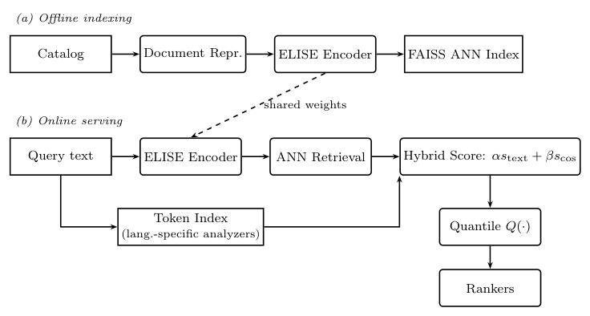
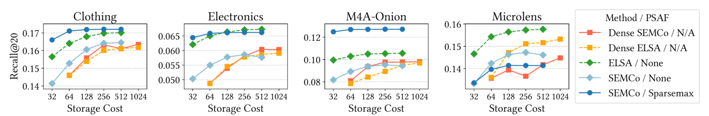

When a user describes a topic in words that never appear in the document it makes sense to implement semantic retreival. If not already in place, this could initially be done with a dense vector field. A hbrid union with BM25 search and dense vector search could then also be tested.

Apple Music did this without touching its rankers. The dense score is blended with the text score and mapped back to the text-score distribution, so downstream ranking still sees familiar values [5]. Capping the number of semantic results gave +2.28% conversion and −86.0% no-result queries, and the gain was largest on tail queries (+7.93%). A variant that only gated on a text-match threshold gave +0.81% [5].

It has to be noted that in Snap's ads work, rule-built keyword queries on BM25 beat LLM-generated queries on BM25 for recall (56.0% vs 42.5%) [6]. In Tubi's offline test, BM25 beat a fine-tuned sentence-transformer [7]. In Meta's ad ranker, lexical tokens helped with brand names, numbers and tail terms that compact codes blur [8]. Drug names, trial IDs and dosages would be our equivalent; that mapping is mine.

Mercari runs two ANN indices (image and title text), unions and deduplicates the candidates, and passes them to a reranker. In two-week A/B tests the hybrid retriever raised purchases from the component by 20.4% [9]. 

One thing that would defintely be intersting to try out are sparse embeddings. Although, it has to be noted that none of the sparse papers tests text search (SPLADE/ELSER style) or uses medical or scientific text. All are recommender or ads work on item embeddings, so this could be a novel experiment for our corpus.
Some noteworthy performance examples here would be:
- A top-k sparse model keeps 32 active dimensions out of 1024 and beat dense vectors by 16.6% to 75.5% in cold-item NDCG@20 at comparable storage. On 63,001 items, a 64-d dense float32 table took 16.1 MB against 12.4 MB for the sparse CSR table. Training cost was about 15–20% higher. The setting is offline cold-start with no latency numbers [10].
- A top-k sparse autoencoder (SAE), trained without labels on frozen BGE, Qwen3-Embedding-0.6B and MiniLM vectors, beat dense alternatives in 70 of 78 settings across 13 datasets. It is a 3-page preliminary abstract [11].

I would test two arms against the hybrid, on the judge set from before:
1. An SAE trained on our dense embeddings, indexed as a sparse field. Elasticsearch has a `sparse_vector` field type, so it should fit the stack. 
2. The SAE codes as extra features for the existing ranker, so the retrieval stays unchanged and the ranker learns how much weight to give them.

If neither beats dense on tail-query recall at equal index size and acceptable p95 latency, I drop it.

[5] Multilingual Semantic Retrieval for Apple Music Search — https://doi.org/10.1145/3773078.3831917

[6] SMART: LLM-Augmented Hybrid Retrieval for Dynamic Product Ads — https://doi.org/10.1145/3773078.3831922

[7] TubiFM: Unified Item, Carousel, and Search Ranking for Streaming Discovery — https://doi.org/10.1145/3773078.3831899

[8] The Text on the Creative: An Under-Exploited Ranking Modality for Short-Form Video Ads — https://doi.org/10.1145/3773078.3831887

[9] Hybrid Retrieval and Multimodal Reranking for Item-to-Item Recommendation in a C2C Marketplace — https://doi.org/10.1145/3773078.3831894

[10] Learning Sparse Representations of Multimodal Content for Enhanced Cold Item Recommendation — https://doi.org/10.1145/3773078.3831760

[11] Sparse Autoencoders as Semantic Domain Adapters for Recommender Systems — https://doi.org/10.1145/3773078.3841253
