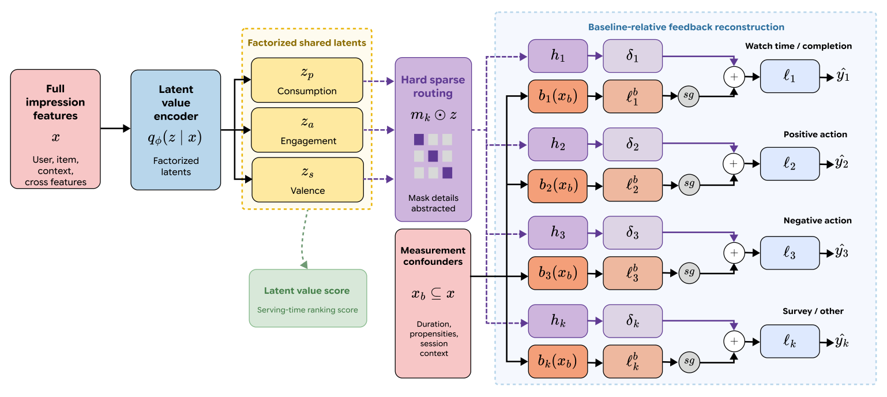

After we optimize to get better candidates, we can focus on a ranker to decide their order (i.e., a two-tower model). 

One potential idea is to revisit learning-to-rank models on the union of BM25 and dense candidates. This could be LambdaMART, as Snap did [6], or another gradient-boosted reranker. Features could here be as defined by the task:
- specialty match
- drug match
- KOL match
- conference, including whether it is upcoming or past
- recency
- the BM25 and dense scores as described previous

Mercari is the closest evidence that this pays off. Its reranker, with category, brand, price and freshness features, added another 12.7% purchases on top of the hybrid retriever. Removing the structured metadata hurt offline AUROC the most (0.656 to 0.638), while the text embedding added little [9]. 

Here we should watch for fixed recency decay. On YouTube Music, a recency boost gave −0.74% on new-release engagement (not significant), and its effect on impressions faded within days. An uncertainty-based boost gave +7.75% [13]. So recency should be a learned feature. Conferences probably also need "upcoming vs past", not only age. That is my assumption; the papers do not cover it.

Also to note, clicks favour whatever the old ranker put on top. Mercari trained only on items users see without scrolling, which they chose over Position-bias Aware Learning and Inverse Propensity Weighting as the simplest option [9]. A control-function method models how the old ranker ordered items and uses the residuals in the click model, with no propensity estimates [15]. 

Watch time has its own bias. It depends on video length, and the completion ratio favours short videos, so a catalogue that mixes short clips with long webinars and congress sessions makes both misleading. FLVM treats watch time, completion, likes, dislikes and skips as noisy measurements of one latent value, with a baseline path for duration, session context and user propensity [16]. On YouTube Shorts it lifted the main viewer-enjoyment metric by 2.67% in a 14-day A/B test. Overall completion PR-AUC dropped (0.6898 to 0.6722): better on videos over 60 s, worse on shorter ones [16]. A cheap first test is a duration-conditioned baseline, with raw completion as the control arm. The full latent model needs several feedback signals, so it comes later.

A few things I would leave for later:
- If congress weeks make click patterns drift, Amazon's DART forecasts group-level behaviour a few days ahead and feeds it to the ranker (+11.11% MRR during events, offline) [17].
- If users should pick "more specialty-focused" or "more KOL-focused" at query time, LinkedIn's subspace partitioning gives request-time weights over one embedding. It needs the entity tagger from Step 2 [18].
- If we add an LLM reranker, shuffling the candidate order changes its rankings [19], and QuintoAndar's LLM re-ranking added 4.2 s [1]. Before shipping one, I would shuffle, rerun, measure Kendall's τ, and compare a single pass against aggregated passes.

[1] LLM-Based Re-Ranking for Real Estate Search — https://doi.org/10.1145/3773078.3831907

[6] SMART: LLM-Augmented Hybrid Retrieval for Dynamic Product Ads — https://doi.org/10.1145/3773078.3831922

[9] Hybrid Retrieval and Multimodal Reranking for Item-to-Item Recommendation in a C2C Marketplace — https://doi.org/10.1145/3773078.3831894

[12] The Illusion of Control: Commensurability, Concentration, and Correlation in Multi-Objective Recommendation — https://doi.org/10.1145/3773078.3841251

[13] Breaking the Loop: An Empirical Comparison of Strategies for Novelty and Freshness in YouTube Music — https://doi.org/10.1145/3773078.3831876

[14] FLUID: From Ephemeral IDs to Multimodal Semantic Codes for Billion-Scale Livestreaming Recommendation — https://doi.org/10.1145/3773078.3831918

[15] A Control Function Framework for Mitigating Position Bias in Learning to Rank Systems — https://doi.org/10.1145/3773078.3831824

[16] Mend the Measurement Gap: Latent User Preference Modeling for Short-Form Video Recommendation — https://doi.org/10.1145/3773078.3831923

[17] DART – Drift Aware Ranking with forecasTing and uncertainty — https://doi.org/10.1145/3773078.3831908

[18] Embedding Subspace Partitioning for Dynamic Multi-Objective Retrieval — https://doi.org/10.1145/3773078.3831892

[19] Position Bias Induces Inconsistent Rankings in Listwise LLM-based Recommendation — https://doi.org/10.1145/3773078.3831801
