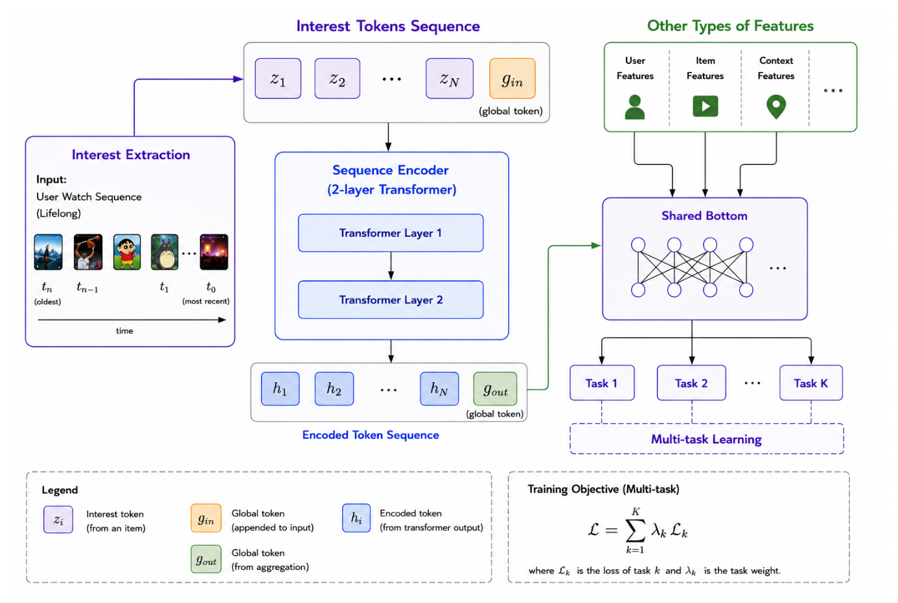

It has to be noted that a ranker orders results the same way for everyone. An oncologist and a cardiologist who both type "immunotherapy" want different things, so personalization goes in as extra ranker features, not as a separate system.

Apple TV added a user vector (the mean of watched-item embeddings) as two similarity features in its existing ranker. Gains were largest for 1–3 character prefixes (+8.63% NDCG@10) and grew with history length (+2.13% to +4.37%). Users without history, or who opted out, get a "missing" value [20]. This can be copied by having a user vector from clicked or saved content. New users fall back to their declared specialty (my assumption).

UITP goes further and builds an explicit interest profile. It accumulates a user's lifetime feedback per node of a hierarchical video taxonomy: playback count, positive playback (at least 90% watched), negative playback (swiped away in under 4 s), like and dislike ratios, each with a 7-day version. The top 100 second-level interests, sorted by lifetime playback count, become tokens for the ranker [21]. Online, exploratory views rose 2.43%, global inter-category diversity 4.74% and satisfied views 1.07% [21].

"Positive playback" also needs the duration correction. 90% of a three-minute clip and 90% of an hour-long session are different signals that need to be taken into account.

[20] Personalizing Incremental Video Search with Hybrid Text and ID Embeddings — https://doi.org/10.1145/3773078.3831896

[21] Interest Sequence for User Modeling in Industrial Short-Form Video Recommendation — https://doi.org/10.1145/3773078.3831901
