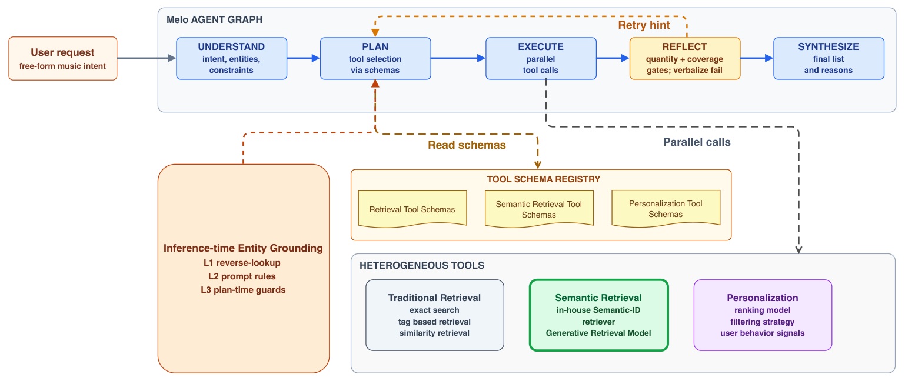
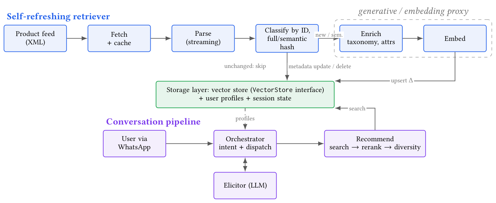
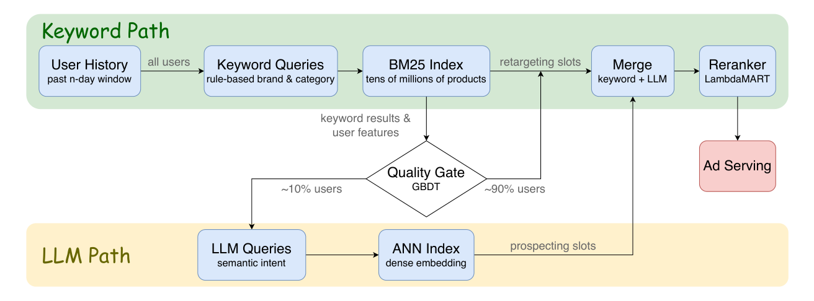

With retrieval and ranking in place, the AI Assistant sits on top of them. The result list and the answer card come from the same candidate set, and the assistant never writes the result list.

The papers agree on keeping the LLM out of retrieval. In my own work, I looked at the LLM for intent and clarifying questions, and to keep retrieval, rerank and diversity non-generative [23]. Melo runs a fixed graph (understand, plan, execute, reflect, synthesize) over existing search tools, because a free-form agent compounded errors [24]. A design-space study found that structured, inspectable retrieval access mattered most; removing it cost about a third of success rate [25]. It is a single-setting thesis abstract, so I treat it as weak evidence.

Not every query needs an answer. Snap routes only ~10% of users to the LLM path through a cheap gate, with 56.6% recall at 0.1× the cost of always-on (54.5%) [6]. I would gate the same way. Navigational queries ("ASCO 2026 programme") get results only. Question-like queries get an answer card.

Here we also have to take latency into consideration. Melo's retry costs a P50 of 15.9 s [24], and QuintoAndar's LLM re-ranking added 4.2 s [1]. So results render immediately and the answer card streams in after them.

[1] LLM-Based Re-Ranking for Real Estate Search — https://doi.org/10.1145/3773078.3831907

[6] SMART: LLM-Augmented Hybrid Retrieval for Dynamic Product Ads — https://doi.org/10.1145/3773078.3831922

[23] Conversational Recommendation over Live E-Commerce Catalogues with Self-Refreshing Retrieval — https://doi.org/10.1145/3773078.3841297

[24] Melo: A Production LLM-Powered Music Recommendation Agent — https://doi.org/10.1145/3773078.3831935

[25] A Design-Space Approach to Robust Agentic Conversational Recommendation — https://doi.org/10.1145/3773078.3831946

[26] How Faithful Is the Reasoning of LLM Recommenders? A Counterfactual Audit — https://doi.org/10.1145/3773078.3841294
